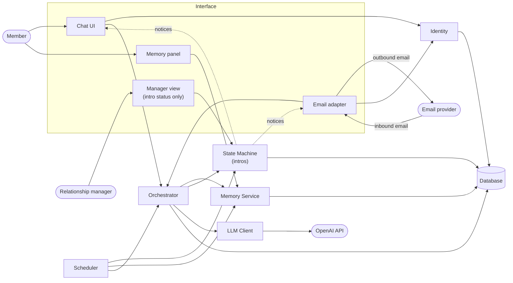
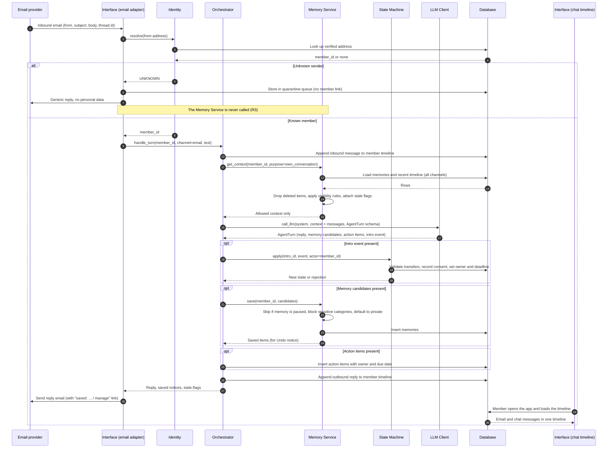

# Architecture

This document describes the components of the Concierge with Memory, how they call each other, and which component owns each requirement from [discovery.md](discovery.md). It is a design document: no code yet.

## Design principles

These come straight from the discovery's privacy limits and technical hypotheses.

1. **Identity first.** Every inbound message is resolved to a member (or to "unknown") before anything touches memory. An unknown sender never reaches the Memory Service (H4, R3).
2. **Filter before the model.** The Memory Service decides what the model may see. The LLM Client only receives text that already passed the permission filter, and it has no access to the database (H2, R6).
3. **One timeline per member.** Messages are stored by `member_id`, not by channel or address, so chat and email form a single history (R2).
4. **Intros are a state machine, not a conversation.** Each intro state has an owner and a deadline, and consent is a recorded event, not something inferred from text (H3, R4, R5).
5. **Remember visibly.** When the agent saves a memory, the member sees a subtle "saved" notice with Undo, and can manage everything in a memory panel (H1, R1).

## Components

| Component | Responsibility | Does **not** |
| --- | --- | --- |
| **Interface** | Member chat (Streamlit), memory panel, manager view of intro status, and the email adapter (inbound and outbound). Shows "saved" notices with Undo. | Decide what data a user may see. It only renders what the Orchestrator or Memory Service returns. |
| **Identity** | Maps a login session or an email address to a `member_id`, or returns `UNKNOWN`. Owns the list of verified addresses per member. | Read memories or messages. |
| **Database** | Single source of truth: members, identities, messages (timeline), memories, action items, intros, consent records, audit log. | Contain business rules. |
| **Memory Service** | CRUD for memories, visibility and permission filtering, pause flag, sensitive-category rules, staleness flags, "delete everything". | Call the LLM. |
| **Orchestrator** | Handles one conversational turn: assembles allowed context, calls the LLM, interprets the structured result, and dispatches memory writes, action items and intro events. | Access memories directly in the database, or change intro state without going through the State Machine. |
| **State Machine (intros)** | Enforces valid intro transitions, requires recorded consent from both sides to advance, and sets an owner and deadline for each state. | Write messages to members. It emits events and the Interface delivers them. |
| **Scheduler** | Periodic jobs: expire unanswered intro requests after 3 days, remind owners of due action items, and run the staleness scan. | Hold its own state. It reads and writes through the other services. |
| **LLM Client** | `app/llm.py`: `call_llm(system, messages, schema)` with structured outputs, timeout, one retry, and token/latency logging. | Read the database or decide permissions. |

## Component diagram

Arrows mean "calls". The LLM Client is reachable only through the Orchestrator, and memories are reachable only through the Memory Service.

Notes:

- `orch --> db` is limited to the message timeline and action items. Memories always go through the Memory Service.
- `sched --> orch` is used for action-item reminders, which need wording from the LLM. Expiry notices are fixed templates sent by the State Machine.
- The manager view reads intro states and deadlines, never message content (privacy limit 3).

## Sequence: an inbound email, from identity to the displayed reply

## Requirements ownership

| ID | Requirement | Owner | Supporting components |
| --- | --- | --- | --- |
| R1 | Members can view, edit, delete and pause their memories | **Memory Service** | Interface (memory panel, Undo notice), Database |
| R2 | Chat and email from the same member form one timeline | **Identity** | Database (timeline keyed by `member_id`), Orchestrator (appends every turn) |
| R3 | Unknown senders access no memory | **Identity** | Orchestrator (never called with an unresolved sender), Interface (generic reply) |
| R4 | An intro only advances with recorded consent from both sides | **State Machine** | Database (consent records), Orchestrator (turns replies into consent events) |
| R5 | Unanswered requests expire after 3 days with notice | **Scheduler** | State Machine (expire transition and notice), Interface (delivers notice) |
| R6 | Memories have visibility: private, shareable, internal | **Memory Service** | Database (visibility column), Orchestrator (states the purpose of each context request) |
| R7 | Action items extracted from conversation have an owner and due date | **Orchestrator** | LLM Client (structured extraction), Database, Scheduler (reminders) |
| R8 | The agent flags memories that may be stale | **Memory Service** | Scheduler (periodic scan), Orchestrator (asks the member to confirm during conversation) |
| R9 | Assistant emails count as the member's if registered | *Out of scope* | Identity is designed to hold several verified addresses per member, so this fits later without changing other components. |

## Visibility rules (R6)

How the Memory Service filters memories, depending on who is asking and why:

| Visibility | Owner's own conversation | Intro matching and intro messages to another member | Team / manager view |
| --- | --- | --- | --- |
| `private` | Yes | Never | No |
| `shareable` | Yes | Used for matching (as a one-line reason). Shown in full only for the items the owner selects when consenting to that specific intro | Only the one-line match reason |
| `internal` | Yes (members can see everything stored about them) | Never | Status and logistics only |

Rules that apply regardless of visibility:

- Personal life and health categories are never used for intros (privacy limit 1).
- Deleted memories are removed, not hidden. "Delete everything" removes all memories and the timeline for that member (privacy limit 4).
- While memory is paused, the Memory Service rejects new writes but still serves existing memories.

## Intro states (R4, R5)

The full state machine, with owners, deadlines, guards and open questions, is in [model.md](model.md#3-intro-state-machine). In short: each state has an owner and a deadline, and `introduced` is only reachable when consent events exist for both sides.

## Open decisions

- **Email transport.** Streamlit cannot receive webhooks. Options: a small HTTP endpoint (for example FastAPI) for the email provider's inbound webhook, or polling an inbox from the Scheduler. For the first version, a simulated inbox in the UI may be enough.
- **Database on Railway.** The container disk is temporary, so the database needs Railway Postgres or a Railway Volume.
- **Staleness rules.** Start simple: flag memories about role and company that have not been confirmed in N months, plus contradictions detected during conversation.
