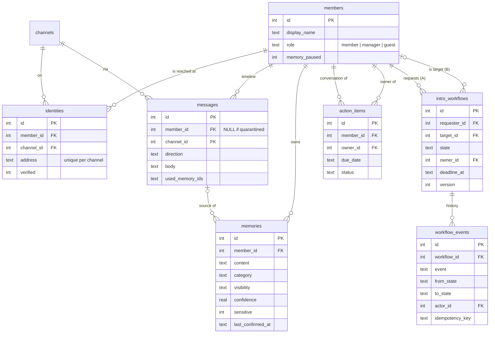
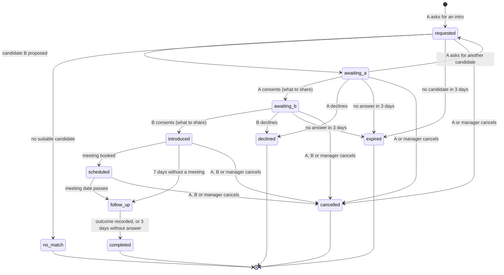

# Data model and intro state machine

This is the reference for state management in the Concierge with Memory: what is stored, how identity works, and how an introduction moves from request to follow-up. The SQLite schema is in [app/schema.sql](../app/schema.sql). Decisions referenced here come from the [PRD](prd.md).

## 1. Modeling notes

### Memory

A memory is one durable fact the member said, with enough metadata to show it, filter it and question it later.

| Field | Why it exists |
| --- | --- |
| `content` | The fact, in plain language, as shown in the memory panel. |
| `category` | Drives rules: `personal` and `health` are sensitive; `role` and `company` are checked for staleness. |
| `source_message_id`, `source_excerpt`, `channel_id` | Where it came from. The member can see why the agent "knows" something. |
| `created_at`, `last_confirmed_at` | When it was saved and when the member last confirmed it (R8). |
| `visibility` | `private` (default), `shareable` or `internal` (R6). |
| `confidence` | How explicit the statement was. Low-confidence candidates are not saved. |
| `sensitive` | Personal life or health. Needs explicit confirmation and can never be `shareable`. |
| `valid_until` | Optional expiry for time-bound facts ("I'm hiring until March"). |

Deleting a memory removes the row. There is no "deleted" flag, because a hidden memory is still a stored memory.

### Identity

- One row in `members` per person, with a `role`: `member`, `manager` or `guest`.
- One row in `identities` per address the person uses, per channel. Roberto with a personal and a work email has two `email` identities pointing to the same `member_id`.
- Only `verified` identities resolve. Matching is exact on the lowercased, trimmed address; a similar address is an unknown sender (PRD decision).
- A message from an unknown sender is stored with `member_id = NULL` and `quarantined = 1`, so it never enters anyone's timeline.

### Timeline

`messages` holds both channels for a member, ordered by `created_at` (R2). An outbound reply stores `used_memory_ids`, so the interface can show which memories shaped the answer.

### Intro workflow

`intro_workflows` holds the **current** state, owner and deadline of each intro. `workflow_events` is the **append-only history**: every transition, who caused it and, for consent events, what was authorized. Consent is never inferred from the current state; it is proved by an event (R4).

Two fields make transitions safe to retry when the LLM or the app fails in the middle:

- `version` on the workflow: a transition only applies if the version it read is still current.
- `idempotency_key` on the event: the same transition sent twice is recorded once.

## 2. Entity diagram

## 3. Intro state machine

### States

| State | Pending owner | Deadline | Notes |
| --- | --- | --- | --- |
| `requested` | Manager | 3 days | A has asked; the agent suggests candidates, the manager confirms one. |
| `awaiting_a` | A | 3 days (R5) | A approves this specific candidate and what B may see about A. |
| `awaiting_b` | B | 3 days (R5) | B sees A's name, the reason and only what A authorized, and decides what A may see. |
| `introduced` | A and B | 7 days | Both consents recorded. The intro message is sent to both. |
| `scheduled` | — | `meeting_at` | Meeting booked (set manually in the prototype). |
| `follow_up` | Manager | 3 days | Ask both sides how it went; the answer is stored in `outcome`. |
| `completed`, `no_match`, `declined`, `expired`, `cancelled` | — | — | Terminal. A notice is sent to the people involved. |

Reminders: the pending owner gets one reminder 1 day before each deadline.

### Guards

- `awaiting_b → introduced` requires `a_consented` and `b_consented` events for this workflow. This is the R4 rule, checked by the State Machine, not by the model.
- A shareable memory about A can be shown to B only after `a_consented`, and only the items listed in that event's payload.
- Every transition writes one `workflow_events` row in the same database transaction as the state change.

## 4. States and transitions added to the original sketch

The original sketch was: request, awaiting A, awaiting B, scheduled, follow-up, plus decline, expiry and cancellation. These were added because the flow cannot be built without them:

| Added | Why |
| --- | --- |
| `no_match` | A request can end without any candidate. Without this state it would stay in `requested` forever. |
| `introduced` | Both consented but no meeting yet. Merging it with `scheduled` would count intros as booked meetings, which breaks the main PRD metric. |
| `completed` | `follow_up` needs an end, otherwise every successful intro stays open. |
| `awaiting_a → requested` | A rejects the proposed candidate but still wants an intro. Without it, A would have to start over. |
| `requested → expired` | R5 says unanswered requests expire; a request nobody picks up is also unanswered. |
| Cancellation from every non-terminal state | Consent can be withdrawn at any point (see decisions below). |
| `introduced → follow_up` and the `follow_up` deadline | Without them, an intro where nobody books a meeting or answers the follow-up never closes. |

## 5. Decisions

These rules were not defined in discovery. They were decided for the prototype and can be revisited with community leadership.

| Question | Decision | Reason |
| --- | --- | --- |
| Who proposes the candidate in `requested`? | The agent suggests up to 3 candidates using only `shareable` memories; the manager confirms one, which moves the intro to `awaiting_a`. | Keeps a human in the loop for the most sensitive step, and uses the manager's knowledge of the community. |
| Can managers start intros on their own? | No. Every intro starts with a member request. | Consent stays simple: the person who benefits always asked first. |
| Deadlines for `requested`, `introduced` and `follow_up` | 3 days, 7 days and 3 days. One reminder 1 day before every deadline. | Same 3-day rhythm as R5; booking a meeting between executives realistically takes about a week. |
| What happens when deadlines pass after consent? | `introduced` without a meeting goes to `follow_up`; `follow_up` without an answer goes to `completed` with outcome "no answer". | Both people already agreed, so the intro is not "expired"; it just needs to close. |
| Can A or B cancel after `introduced`? | Yes, at any point before `follow_up`. Cancelling stops reminders and notices; it cannot take back contact details already shared. | Consent can be withdrawn; the product is honest about what can't be undone. |
| What does A learn when an intro does not happen? | One neutral notice for decline, expiry and cancellation: "This intro won't go ahead." No reason is given. | Protects B's privacy and avoids awkwardness, which was the original pain. |
| Can A ask again for someone who declined? | Not for 90 days. A gets the same neutral notice. | Respects B's decision without revealing it. |
| Does B learn who A is before consenting? | Yes: A's name, A's reason, and only the items A authorized. | B cannot give informed consent to an anonymous request. |
| "Delete everything" or leaving the community with open intros | Open intros are cancelled; the other side gets the neutral notice. `workflow_events` keep ids, states and timestamps only; payloads are cleared. | Honors privacy limit 4 while keeping proof that consent existed. |
| What can a guest do? | Chat with the concierge for general help only. No memories are stored, and guests can't request or receive intros. | Intros and memory are member benefits; guests have not accepted the community's terms. |
| Duplicate requests for the same pair | Blocked while an intro between the two is open in either direction; the requester is pointed to the existing one. | Avoids two parallel consent flows for the same people. |
| Should members see `internal` memories about themselves? | Yes. | R1 says members can view their memories; hiding some would break trust. |
